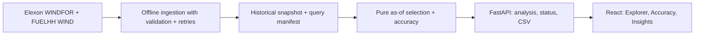

# WindSight

**Day-Ahead Wind Generation Intelligence** — an auditable pilot for exploring which national wind forecast was available at a purchasing decision and how it compared with observed generation.

Live application: **publication pending**. Public repository: **publication pending**. The application works locally; no public deployment or video upload is claimed until independently verified.

## Features

- Forecast Explorer: January decision date and configurable UK cutoff, native forecast targets, actual overlay, selected interval, publication time, age and lead time, audit table and CSV.
- Forecast Accuracy: MAE, RMSE, mean signed bias, sample counts, coverage, daily comparisons and signed-error distribution.
- Decision Insights: fixed calculations describing bias, historical error magnitude, largest discrepancy and data availability. No language model generates insights.
- Transparent provenance: exact Elexon requests, retrieval dates, snapshot fingerprint and visible assumptions. Loading, error, retry and empty states; responsive controls and keyboard access.

## Architecture and files

React 19 + TypeScript + Vite + Recharts; Python 3.13 + FastAPI + Pydantic + HTTPX; a versioned JSON snapshot; pytest + Playwright; Docker and Vercel configuration. CSS tokens provide the visual system without an extra component framework. Python dependencies are locked in `uv.lock` and exported to fully pinned `requirements.txt`; frontend dependencies are exact and locked in `package-lock.json`.



```text
app.py                       Single-origin production / Vercel entrypoint
backend/app/ingestion.py      Official API downloads, raw cache, snapshot manifest
backend/app/models.py         UTC-aware source and response contracts
backend/app/analytics.py      As-of selection, exact joins, metrics, insights
backend/app/store.py          Snapshot loading and SHA-256 verification
backend/app/api.py            Validated API routes and CSV
backend/tests/               Analytical, API, real-data and ingestion tests
frontend/src/components/     Shell, metrics, charts, audit table
frontend/src/pages/          Explorer, Accuracy, Insights, Methodology
frontend/src/hooks/          Cancellable API request lifecycle
frontend/tests/              Browser regression workflows
data/processed/              Genuine historical snapshot and manifest
data/README.md               Query parameters, refresh and source limitations
docs/                        Requirements, verification, learning, demo, submission
Dockerfile, docker-compose.yml   Reproducible single-origin local runtime
vercel.json, pyproject.toml  Vercel Python preset and build configuration
```

## Run with Docker

Prerequisite: Docker Desktop / Docker Engine with Compose. The genuine cached data is included; no API key, database or ingestion step is needed to open the app.

```sh
docker compose up --build -d
```

Open [http://localhost:8000](http://localhost:8000) and [API documentation](http://localhost:8000/docs). `docker compose ps` shows health. Stop with `docker compose down`. Set `WINDSIGHT_PORT=8010` in `.env` to use another local port; `.env.example` lists options. Compose binds to loopback and runs a non-root, read-only container. Container port stays 8000.

## Run without Docker

Prerequisites: Python 3.13, Node.js 24 (or a compatible supported Vite release), npm, and [uv](https://docs.astral.sh/uv/). From the repository root:

```sh
uv sync --frozen
npm ci --prefix frontend
npm run build --prefix frontend
uv run uvicorn app:app --host 127.0.0.1 --port 8000
```

For hot reload, run `uv run uvicorn app:app --reload` in one terminal and `npm run dev --prefix frontend` in another. Vite proxies `/api` to port 8000. The generated backend docs remain on port 8000. A plain virtual environment with `pip install -r requirements.txt` can run the application; use uv for the locked development and test dependencies.

## Data, selection and accuracy

Only official Elexon [WINDFOR](https://bmrs.elexon.co.uk/api-documentation/endpoint/datasets/WINDFOR/stream) and [FUELHH WIND](https://bmrs.elexon.co.uk/api-documentation/endpoint/datasets/FUELHH/stream) are used. No other energy dataset is substituted.

Decision dates are **1–31 January 2026, Europe/London**. Delivery is the next UK calendar day, **2 January–1 February**. The default **12:00 UK** cutoff is a configurable illustrative assumption, not an asserted official market gate closure. Internal timestamps are aware UTC. For every target:

1. Keep forecast versions where `publishTime <= decision timestamp`.
2. Choose the latest eligible publication independently for that target.
3. Match the WIND outturn at exactly the same `startTime`.
4. Include only valid pairs in error metrics. Retrospective actuals are not decision-time information.

`error = forecast MW − actual MW`; positive means overprediction. **MAE** is mean absolute error. **RMSE** is the square root of mean squared error. **Bias** is mean signed error. **Coverage** is matched pairs / all next-day half-hour timestamps, plus any irregular native forecast targets. **Eligible-match coverage** is matched pairs / eligible forecasts. Every aggregated error metric reports its sample size. The 90th percentile of absolute error uses nearest rank.

The snapshot contains **17,864 forecast versions** and **1,488 actual records**, retrieved **28 October 2026**. Forecast target cadence is **hourly**, actual cadence **half-hourly**. At noon: **744 pairs / 1,488 half-hours = 50% coverage**, and **100% of eligible forecasts match**. Full-month noon MAE is **1,883.98 MW**, RMSE **2,350.33 MW**, and bias **+1,685.27 MW**. These values are reproducible from the included snapshot, not expected values for future wind forecasts.

No missing record becomes zero; no interpolation, forward-fill, MAPE or MW-to-MWh summation is used. The UI renders forecasts as discrete points. Line segments between consecutive actual observations are a visual aid, not generated data. National metered wind in these sources need not include every embedded wind installation. Demand, prices and procurement requirements are absent; the product cannot calculate a purchase quantity or financial impact.

Refresh / reproduce:

```sh
uv run python -m backend.app.ingestion
```

Daily chunks, retries, schema checks, duplicate rules, publication warmup, hashes and refresh caveats are documented in [data/README.md](data/README.md). The application serves the verified snapshot without an upstream call. Stop/restart workers when replacing the cache. Source revisions may change a fresh retrieval.

## API and verification

- `GET /api/health`: verified cache status and counts (503 if unavailable).
- `GET /api/dates`: supported decision dates and default cutoff assumption.
- `GET /api/analysis?start_date=2026-01-01&end_date=2026-01-31&cutoff=12:00`: intervals, metrics, daily results, insights and provenance.
- `GET /api/export.csv` with the same query: exact interval audit, nulls exported as empty fields.
- `/docs`, `/openapi.json`: generated API contracts. Invalid ranges or offset-bearing cutoffs return 422.

```sh
uv run pytest -q
uv run ruff check backend app.py
npm run build --prefix frontend
npm run test:e2e --prefix frontend
```

Browser tests use installed Google Chrome (`channel: chrome`). If Chrome is unavailable, install Playwright Chromium with `npx playwright install chromium` from `frontend/` and remove the channel override in the test configuration. Tests start a local production server if needed, so build the frontend first. To target another deployment, set `WINDSIGHT_BASE_URL` before running tests. The suite checks real interactions plus clearly isolated intercepted error/empty responses; synthetic values are never shipped as production data.

Executed results and remaining checks are in [docs/verification.md](docs/verification.md). The demonstration script and exact recording sequence are in [docs/video-walkthrough.md](docs/video-walkthrough.md). Publication and final form submission steps are in [docs/submission.md](docs/submission.md).

## Deployment and limitations

Vercel's supported FastAPI preset loads `app.py`; the build command compiles React, and the static mount serves the frontend on the same origin. The historical snapshot is bundled read-only. No durable writable disk or background ingestion is required. See [Vercel's FastAPI documentation](https://vercel.com/docs/frameworks/backend/fastapi). Production publication still needs to be executed and verified; configuration alone is not evidence of successful deployment.

This is a bounded historical pilot. It has no live data refresh, user accounts or persistent saved filters. A two-day publication warmup supports the first decision; earlier publications outside that window are not retained. It does not prove every historical revision was available at precisely the recorded publication time. Error samples are observations in MW rather than independent statistical trials or energy volumes. Sparse target matching can make the sample unrepresentative of intervening half-hours. No confidence guarantee is inferred.

## AI assistance

**OpenAI Codex and other AI tools assisted development**, including requirements extraction, implementation, design concepting, tests and documentation. The quantitative insights use deterministic code over genuine Elexon records. AI assistance and passing tests do not replace the author's responsibility to understand and explain the submission.
